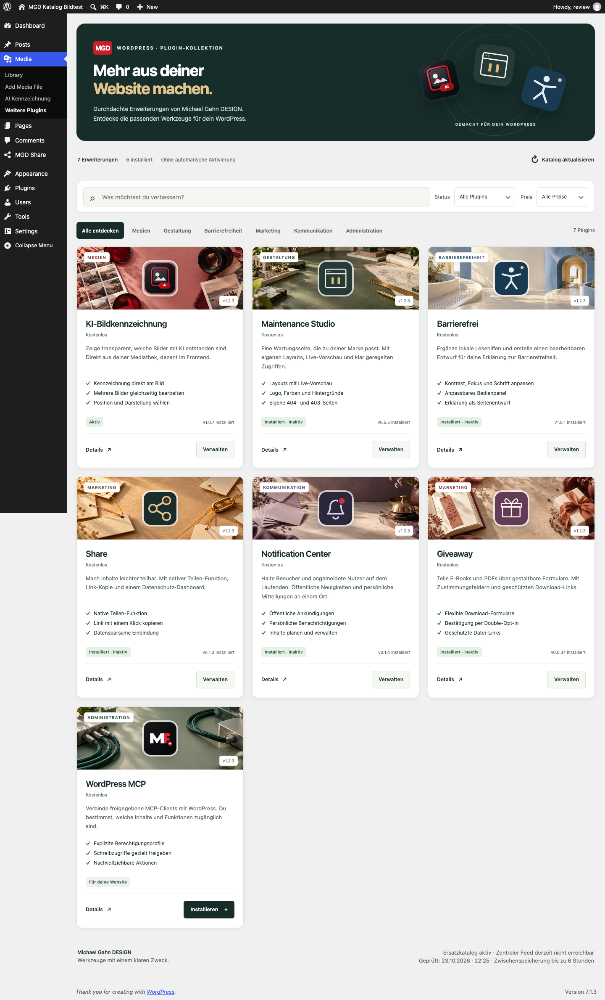

# Änderungsprotokoll

Alle Änderungen am MGD Notification Center für WordPress, neueste zuerst.

## [2.2.0] - 2026-11-27

- MGD Tools immer farbig hervorgehoben, neue Einstellung Primärfarbe für alle MGD-Plugins (Baukasten 1.17.0).

## [2.1.4] - 2026-11-26

- MGD Tools: inaktive MGD-Plugins in der Übersicht, alle Karten in Weitere Plugins (Baukasten 1.16.1).

## [2.1.3] - 2026-11-26

- MGD Tools: Plugins an- und abschalten, Lizenz je Plugin.

## [2.1.1] - 2026-11-24

- Gemeinsame Verwaltung unter MGD Tools, einheitliche Darstellung, Icons.
- Das Notification Center hängt jetzt unter dem Menüpunkt „MGD Tools“. Meldungen und Einstellungen sind zwei Reiter auf einer Seite.
- Info, Updates, Lizenz und Weitere Plugins stehen zentral unter „MGD Tools“.
- Alter Update-Code und alte Plugin-Kollektion sind entfernt.

## 1.6.2 – Neue Ansicht „Weitere Plugins“ (22.11.2026)

- „Weitere Plugins“ (unter Notification Center → Info und Updates) hat jetzt das Design der MGD Plugin-Kollektion: Bilder, Kategorien, Suche, Filter und ein Details-Fenster.
- Kostenlose Plugins kannst du dort mit einem Klick installieren. Sie werden nie automatisch aktiviert.
- Die alte Seite „Weitere Plugins“ ist ganz entfernt.

## 1.6.1 – Aufgeräumt (21.11.2026)

- Die alte Seite „Weitere Plugins“ wird nicht mehr geladen. Die Liste steht jetzt nur noch unter **Notification Center › Info und Updates**.
- Sonst keine Änderungen. Einstellungen und Meldungen bleiben erhalten.

## 1.6.0 – Updates und Infos über theme.michael-gahn.de (21.11.2026)

- Neue Seite **Notification Center › Info und Updates**. Dort stehen die Version, ob es ein Update gibt, die Liste „Weitere Plugins“ und der Schalter „Installation melden“.
- Updates kommen jetzt von theme.michael-gahn.de. Vor der Installation prüft das Plugin Größe und Prüfsumme der ZIP-Datei. Automatische Updates bleiben aus, bis du sie selbst einschaltest.
- Der alte Update-Weg über GitHub ist abgeschaltet. Ältere Versionen finden dieses Update trotzdem noch über GitHub.
- Beim Löschen des Plugins meldet es sich bei theme.michael-gahn.de ab. Deine Meldungen und Einstellungen bleiben, außer du hast das vollständige Löschen eingeschaltet.
- Deine Einstellungen und Meldungen bleiben beim Update erhalten.

## 1.5.0 – Anmeldung bei theme.michael-gahn.de (18.11.2026)

- Meldet sich höchstens einmal am Tag bei theme.michael-gahn.de (Plugin, Version, Shopsystem, Domain, zufällige ID). Abschaltbar in den Einstellungen.
- Das Plugin meldet sich im Admin an, danach höchstens einmal am Tag. Gesendet werden nur Plugin, Version, Shopsystem, Domain und eine zufällige ID.
- Der Schalter „Installation bei Michael Gahn DESIGN melden“ steht unter Notification Center › Einstellungen. Er ist ab Werk an. Abschalten löscht den Eintrag auf der Plattform. Das Plugin funktioniert dann genauso weiter.

## 1.4.0 – Versionsangleichung (14.11.2026)

- Alle MGD-Themes und -Plugins stehen auf 1.4.0 (höchste gemeinsame Version). Inhaltlich wie 0.7.1.

## 0.1.2 – Plugin-Verwaltung

Separate Update-Prüfung, Plugin-Links und ergänzte lokale Details. [Anleitung](docs/WORDPRESS-VERWALTUNG.md).

## 0.1.3 – Neue Plugin-Kollektion

Die bisherige Empfehlungstabelle wird zur Plugin-Kollektion mit eigenen Icons, vollständigen Beschreibungen, Suche, Kategorie-, Status- und Preisfiltern. Details öffnen sich im Dialog; Installationen bleiben ausdrücklich bestätigt und aktivieren kein Plugin automatisch. Die Übersicht funktioniert auch mit noch älteren MGD-Katalog-Verbrauchern.

[Gestaltung, Datenquelle, Sicherheit und Prüfung](docs/PLUGIN-KATALOG.md). Der externe Katalog gehört zur GitHub-Ausgabe; die getrennten WordPress.org-Kandidaten bleiben unverändert.

## 0.1.4 – Updateanzeige nach der Installation

Die Übersicht vergleicht zwischengespeicherte WordPress-Updateangebote zusätzlich mit der tatsächlich installierten Version. Gleiche, ältere oder fehlende Versionsangaben zeigen keine erneute Updateaktion. Sieben Regressionstests sichern diesen Zustand und die Rechteprüfung ab.

## 0.1.5 – Eigene Motive in der Plugin-Kollektion

Sieben passende, lokal mitgelieferte Hintergrundbilder ergänzen die Plugin-Karten. Icons, Suche und Filter bleiben erhalten. [Gestaltung und Herkunft](docs/PLUGIN-KATALOG.md#kartenmotive--24102026).

## 0.1.6 – Redaktion übersichtlicher steuern

Der Redaktionsbereich zeigt den Status der Meldungen auf einen Blick, ist für kleine Bildschirmbreiten optimiert und unterscheidet öffentliche von persönlichen Meldungen klarer. Persönliche Meldungen lassen sich nur noch für vorhandene WordPress-Konten speichern.

## 0.1.7 – Icons und Hintergründe aus dem Feed (27.10.2026)

Icons und Hintergründe der Karten unter „Weitere Plugins“ kommen jetzt aus theme.michael-gahn.de. Der Server holt sie einmal und speichert sie lokal, der Browser lädt nichts extern. Ohne Bild bleibt das mitgelieferte Motiv. Versionen werden ohne führendes „v“ angezeigt.

✅ Der Redaktionsbereich berechnet Liste und Statusübersicht wieder serverseitig. Persönliche Meldungen werden erst beim bewussten Öffnen der einzelnen Meldung als gelesen markiert. Die Glocke lässt sich zusätzlich mit Escape schließen und setzt den Fokus zurück.

⚠️ Die Änderungen sind lokal geprüft, aber noch nicht in einer echten WordPress-Testinstallation per Browser kontrolliert.

## 0.2.0 – Lesestatus und Inhaltsdialog (Quellstand)

„Alles gelesen“ markiert die aktuell geladenen Meldungen bewusst als gelesen. Das reine Öffnen der Glocke markiert nichts. Öffentliche Lesemarken bleiben ausschließlich lokal im Browser, persönliche Lesemarken werden über die bestehende authentifizierte Empfänger-Route gespeichert. Fehlgeschlagene Anfragen werden nicht als Erfolg angezeigt. Blockierter Browserspeicher führt nur zu einem flüchtigen Zustand, nicht zu einem Tracking-Ersatz.

Beim Erstellen und Bearbeiten einer Meldung gibt es „Inhalt als Modal öffnen“. Der Dialog zeigt den vollständigen Benachrichtigungstext als Klartext und gegebenenfalls einen normalen Link. Keine fremden Webseiten, Bilder oder Skripte werden eingebettet. Die Option ist standardmäßig aus und wird pro Meldung als nicht automatisch geladene WordPress-Option gespeichert; eine Tabellenmigration ist nicht erforderlich. Sichtbarkeit und Empfängerrechte bleiben in den bisherigen Abfragen erhalten.

Öffentliche Meldungen verwenden einen neuen revisionsbezogenen Browser-Leseschlüssel. Bestehende pauschale Lesemarken älterer Versionen werden nicht übernommen. Datenbank- und Browser-Release sind getrennt von einer Installation auf einer konkreten Website zu prüfen. Der Download-Link oben verweist weiterhin auf die zuletzt veröffentlichte ZIP-Version.

## 0.3.0 – Alle anzeigen, Ausblenden und Divi 5 (12.11.2026)

- **Anzahl im Panel einstellbar:** Unter „Notification Center → Einstellungen“ steht „Anzahl im Panel“ (1 bis 30). So viele aktuelle Meldungen zeigt die Glocke.
- **Alle anzeigen:** Unten im Panel öffnet ein Fenster mit allen Meldungen. Die Überschriften stehen untereinander. Ein Klick klappt den ganzen Inhalt auf, Links im Text sind klickbar.
- **Alle gelesen** markiert jetzt wirklich alle Meldungen als gelesen, auch die, die nicht im Panel stehen.
- **Ausblenden:** Jede Meldung hat einen Knopf „Ausblenden“. „Gelesene ausblenden“ blendet alle schon gelesenen Meldungen auf einmal aus. Persönliche Meldungen merkt sich der Server, öffentliche der Browser.
- **Divi 5 und andere Page-Builder:** Bei der Platzierung „Im Menü“ kommt die Glocke an das erste Menü der Seite, auch beim Menü-Modul von Divi. Gibt es kein Menü, erscheint sie unten rechts.
- Die Einstellungen haben deutsche Namen und zeigen nach dem Speichern eine Bestätigung.
- **Eigenes Icon statt Emoji:** Die Glocke ist jetzt ein im Plugin eingebettetes SVG-Icon. Unter „Einstellungen → Icon der Glocke“ stehen 10 Icons zur Auswahl (Glocke, Glocke mit Klang, Megafon, Posteingang und mehr). Es wird nichts von außen geladen.
- **Behoben:** Bei den schwebenden Platzierungen und im Footer kam das Skript zu spät. Die Glocke blieb dann leer. Jetzt lädt sie überall ihre Meldungen.
- **Schöneres Backend:** Meldungen und Einstellungen im Karten-Look. Platzierung als Kacheln mit kleiner Vorschau, Anzahl per Regler, Icon-Vorschau oben, Status auf Deutsch, Liste neben dem Formular.

## 0.7.0 – Gleiche Version auf allen Systemen (12.11.2026)

- Die Versionsnummer ist jetzt bei WordPress, JTL-Shop, Shopware und Shopify gleich (0.7.0).
- Behoben: Fehlermeldungen erscheinen im Fenster „Alle anzeigen“, wenn es offen ist (vorher nur im verdeckten Panel).

## 0.7.1 – Glocke im Wartungsmodus (13.11.2026)

- Behoben: Mit einem Wartungs-Plugin (z. B. MGD Maintenance Studio) fehlten angemeldeten Nutzern die öffentlichen Meldungen, und die Glocke meldete „Ein Teil der Benachrichtigungen konnte nicht geladen werden“. Jetzt schickt die Glocke beim öffentlichen Abruf den WordPress-Sicherheitsschlüssel mit, wenn jemand angemeldet ist (nur an die eigene Website). Besucher ohne Anmeldung sehen im Wartungsmodus weiter nichts.
