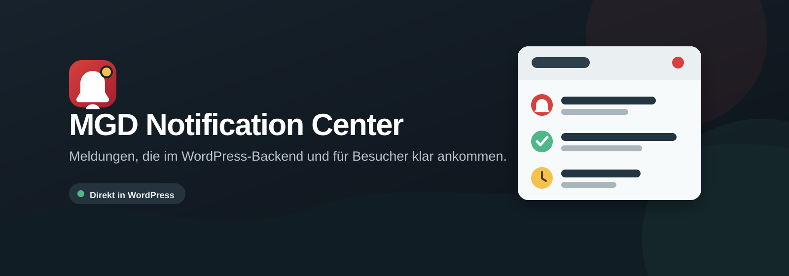
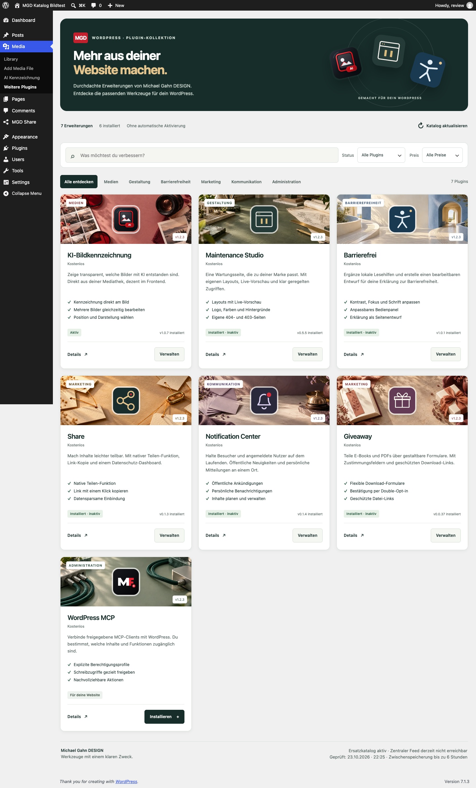

<div align="center">



# MGD Notification Center

**Öffentliche Neuigkeiten und persönliche Benachrichtigungen für WordPress.**

[](https://wordpress.org/)
[](https://www.php.net/)
[](mgd-notification-center/LICENSE)
[](https://github.com/MichaelGahnDESIGN/MGD-Notification-WordPress/releases/latest)

[Testversion herunterladen](https://github.com/MichaelGahnDESIGN/MGD-Notification-WordPress/releases/latest) · [Dokumentation](https://github.com/MichaelGahnDESIGN/MGD-Notification-WordPress/wiki) · [Sicherheitsrichtlinie](SECURITY.md)

</div>

---

MGD Notification Center bringt eine zugängliche Glocke in WordPress. Sie zeigt neue Inhalte, bewusst angekündigte Aktualisierungen und persönliche Meldungen für angemeldete Konten. Alle Daten bleiben auf dem eigenen WordPress-Server: Das Plugin lädt keine externen Schriften, Skripte oder Analyse-Dienste.

> **Status:** Erste Testversion. Bitte zuerst in einer Staging- oder Testumgebung installieren.

## Auf einen Blick

| Bereich | Enthalten |
| --- | --- |
| Öffentliche Meldungen | Neue veröffentlichte Inhalte und redaktionell freigegebene Aktualisierungen |
| Persönliche Meldungen | WooCommerce-Bestellstatus und gezielte Admin-Nachrichten |
| Platzierung | Hauptmenü, Footer, vier schwebende Ecken oder Shortcode |
| Verwaltung | Entwurf, Planung, Veröffentlichung, Bearbeitung und Archivierung |
| Datenschutz | Empfänger, Lesestatus und persönliche Inhalte bleiben serverseitig getrennt |

## Installation

1. Lade [**MGD Notification Center 0.7.1**](https://github.com/MichaelGahnDESIGN/MGD-Notification-WordPress/releases/download/v0.7.1/mgd-notification-center-0.7.1.zip) herunter.
2. Öffne in WordPress **Plugins → Installieren → Plugin hochladen**.
3. Wähle die ZIP-Datei, installiere sie und aktiviere das Plugin.
4. Stelle unter **Notification Center → Einstellungen** die gewünschte Position ein.
5. Erstelle unter **Notification Center → Meldungen** eine öffentliche oder persönliche Testmeldung.

Eine kurze Schritt-für-Schritt-Anleitung steht in der [Wiki-Installation](https://github.com/MichaelGahnDESIGN/MGD-Notification-WordPress/wiki/Installation).

## Funktionen

### Für Besucherinnen und Besucher

- Glocke mit Zahl für ungelesene Meldungen
- Tastaturbedienung und aussagekräftige ARIA-Beschriftungen
- Öffentliche Meldungen ohne Anmeldung
- Persönliche Meldungen nur für das zugehörige angemeldete Konto
- Lokale Speicherung gelesener **öffentlicher** Meldungen im Browser

### Für die Redaktion

- Öffentliche und persönliche Meldungen erstellen und bearbeiten
- Status **Entwurf**, **geplant**, **veröffentlicht** und **archiviert**
- Linkziel je Meldung
- Automatische öffentliche Meldung beim ersten Veröffentlichen eines Inhalts
- Optionaler Hinweis für eine bewusst angekündigte Inhaltsaktualisierung
- Automatische persönliche Meldung bei WooCommerce-Bestellstatusänderungen, wenn die Bestellung einem WordPress-Konto zugeordnet ist

## Platzierung

Die automatische Position stellst du im Backend ein. Für eine frei gewählte Stelle im Theme oder Page Builder steht dieser Shortcode bereit:

```text
[mgd_notification_center]
```

| Einstellung | Ergebnis |
| --- | --- |
| `floating-top-left` / `floating-top-right` | Schwebende Glocke oben |
| `floating-bottom-left` / `floating-bottom-right` | Schwebende Glocke unten |
| `menu` | Ausgabe über den Theme-Menü-Hook |
| `footer` | Ausgabe im Footer |
| `none` | Keine automatische Ausgabe; nur Shortcode oder Theme-Einbindung |

## Datenschutz und Sicherheit

Persönliche Meldungen werden nie über die öffentliche Schnittstelle ausgeliefert. Jede Lese-Markierung wird auf dem Server mit dem angemeldeten WordPress-Konto abgeglichen. Gastbestellungen erhalten absichtlich keine persönliche Statusmeldung, weil es keine sichere Konto-Zuordnung gibt.

Die Details zu Datenmodell, Berechtigungen und Löschverhalten stehen in der [Wiki: Datenschutz und Sicherheit](https://github.com/MichaelGahnDESIGN/MGD-Notification-WordPress/wiki/Datenschutz-und-Sicherheit).

## Testen und Paket erzeugen

```bash
find mgd-notification-center -name '*.php' -exec php -l {} \;
node --check mgd-notification-center/assets/frontend.js
python3 scripts/check-docs.py
python3 scripts/build-package.py
```

Das fertige ZIP liegt anschließend unter `dist/`.

## Dokumentation

- [Installation](https://github.com/MichaelGahnDESIGN/MGD-Notification-WordPress/wiki/Installation)
- [Meldungen verwalten](https://github.com/MichaelGahnDESIGN/MGD-Notification-WordPress/wiki/Meldungen-verwalten)
- [Datenschutz und Sicherheit](https://github.com/MichaelGahnDESIGN/MGD-Notification-WordPress/wiki/Datenschutz-und-Sicherheit)
- [Entwicklung und Tests](https://github.com/MichaelGahnDESIGN/MGD-Notification-WordPress/wiki/Entwicklung-und-Tests)

## Unterstützung

Fehler, Wünsche und nachvollziehbare Verbesserungsvorschläge bitte als [GitHub Issue](https://github.com/MichaelGahnDESIGN/MGD-Notification-WordPress/issues) melden. Bitte keine Zugangsdaten, personenbezogenen Daten oder vollständigen Datenbankauszüge anhängen.

## Lizenz

Dieses Plugin steht unter [GPL-2.0-or-later](mgd-notification-center/LICENSE).

## 0.1.2 – Plugin-Verwaltung

Separate Update-Prüfung, Plugin-Links und ergänzte lokale Details. [Anleitung](docs/WORDPRESS-VERWALTUNG.md).

## 0.1.3 – Neue Plugin-Kollektion

Die bisherige Empfehlungstabelle wird zur Plugin-Kollektion mit eigenen Icons, vollständigen Beschreibungen, Suche, Kategorie-, Status- und Preisfiltern. Details öffnen sich im Dialog; Installationen bleiben ausdrücklich bestätigt und aktivieren kein Plugin automatisch. Die Übersicht funktioniert auch mit noch älteren MGD-Katalog-Verbrauchern.



[Gestaltung, Datenquelle, Sicherheit und Prüfung](docs/PLUGIN-KATALOG.md). Der externe Katalog gehört zur GitHub-Ausgabe; die getrennten WordPress.org-Kandidaten bleiben unverändert.

## 0.1.4 – Updateanzeige nach der Installation

Die Übersicht vergleicht zwischengespeicherte WordPress-Updateangebote zusätzlich mit der tatsächlich installierten Version. Gleiche, ältere oder fehlende Versionsangaben zeigen keine erneute Updateaktion. Sieben Regressionstests sichern diesen Zustand und die Rechteprüfung ab.

## 0.1.5 – Eigene Motive in der Plugin-Kollektion

Sieben passende, lokal mitgelieferte Hintergrundbilder ergänzen die Plugin-Karten. Icons, Suche und Filter bleiben erhalten. [Gestaltung und Herkunft](docs/PLUGIN-KATALOG.md#kartenmotive--24102026).

## 0.1.6 – Redaktion übersichtlicher steuern

Der Redaktionsbereich zeigt den Status der Meldungen auf einen Blick, ist für kleine Bildschirmbreiten optimiert und unterscheidet öffentliche von persönlichen Meldungen klarer. Persönliche Meldungen lassen sich nur noch für vorhandene WordPress-Konten speichern.

## 0.1.7 – Icons und Hintergründe aus dem Feed (27.10.2026)

Icons und Hintergründe der Karten unter „Weitere Plugins“ kommen jetzt aus theme.michael-gahn.de. Der Server holt sie einmal und speichert sie lokal, der Browser lädt nichts extern. Ohne Bild bleibt das mitgelieferte Motiv. Versionen werden ohne führendes „v“ angezeigt.

✅ Der Redaktionsbereich berechnet Liste und Statusübersicht wieder serverseitig. Persönliche Meldungen werden erst beim bewussten Öffnen der einzelnen Meldung als gelesen markiert. Die Glocke lässt sich zusätzlich mit Escape schließen und setzt den Fokus zurück.

⚠️ Die Änderungen sind lokal geprüft, aber noch nicht in einer echten WordPress-Testinstallation per Browser kontrolliert.


## 0.2.0 – Lesestatus und Inhaltsdialog (Quellstand)

„Alles gelesen“ markiert die aktuell geladenen Meldungen bewusst als gelesen. Das reine Öffnen der Glocke markiert nichts. Öffentliche Lesemarken bleiben ausschließlich lokal im Browser, persönliche Lesemarken werden über die bestehende authentifizierte Empfänger-Route gespeichert. Fehlgeschlagene Anfragen werden nicht als Erfolg angezeigt. Blockierter Browserspeicher führt nur zu einem flüchtigen Zustand, nicht zu einem Tracking-Ersatz.

Beim Erstellen und Bearbeiten einer Meldung gibt es „Inhalt als Modal öffnen“. Der Dialog zeigt den vollständigen Benachrichtigungstext als Klartext und gegebenenfalls einen normalen Link. Keine fremden Webseiten, Bilder oder Skripte werden eingebettet. Die Option ist standardmäßig aus und wird pro Meldung als nicht automatisch geladene WordPress-Option gespeichert; eine Tabellenmigration ist nicht erforderlich. Sichtbarkeit und Empfängerrechte bleiben in den bisherigen Abfragen erhalten.

Öffentliche Meldungen verwenden einen neuen revisionsbezogenen Browser-Leseschlüssel. Bestehende pauschale Lesemarken älterer Versionen werden nicht übernommen. Datenbank- und Browser-Release sind getrennt von einer Installation auf einer konkreten Website zu prüfen. Der Download-Link oben verweist weiterhin auf die zuletzt veröffentlichte ZIP-Version.

## 0.3.0 – Alle anzeigen, Ausblenden und Divi 5 (12.11.2026)

- **Anzahl im Panel einstellbar:** Unter „Notification Center → Einstellungen“ steht „Anzahl im Panel“ (1 bis 30). So viele aktuelle Meldungen zeigt die Glocke.
- **Alle anzeigen:** Unten im Panel öffnet ein Fenster mit allen Meldungen. Die Überschriften stehen untereinander. Ein Klick klappt den ganzen Inhalt auf, Links im Text sind klickbar.
- **Alle gelesen** markiert jetzt wirklich alle Meldungen als gelesen, auch die, die nicht im Panel stehen.
- **Ausblenden:** Jede Meldung hat einen Knopf „Ausblenden“. „Gelesene ausblenden“ blendet alle schon gelesenen Meldungen auf einmal aus. Persönliche Meldungen merkt sich der Server, öffentliche der Browser.
- **Divi 5 und andere Page-Builder:** Bei der Platzierung „Im Menü“ kommt die Glocke an das erste Menü der Seite, auch beim Menü-Modul von Divi. Gibt es kein Menü, erscheint sie unten rechts.
- Die Einstellungen haben deutsche Namen und zeigen nach dem Speichern eine Bestätigung.
- **Eigenes Icon statt Emoji:** Die Glocke ist jetzt ein im Plugin eingebettetes SVG-Icon. Unter „Einstellungen → Icon der Glocke“ stehen 10 Icons zur Auswahl (Glocke, Glocke mit Klang, Megafon, Posteingang und mehr). Es wird nichts von außen geladen.
- **Behoben:** Bei den schwebenden Platzierungen und im Footer kam das Skript zu spät. Die Glocke blieb dann leer. Jetzt lädt sie überall ihre Meldungen.
- **Schöneres Backend:** Meldungen und Einstellungen im Karten-Look. Platzierung als Kacheln mit kleiner Vorschau, Anzahl per Regler, Icon-Vorschau oben, Status auf Deutsch, Liste neben dem Formular.

## 0.7.0 – Gleiche Version auf allen Systemen (12.11.2026)

- Die Versionsnummer ist jetzt bei WordPress, JTL-Shop, Shopware und Shopify gleich (0.7.0).
- Behoben: Fehlermeldungen erscheinen im Fenster „Alle anzeigen“, wenn es offen ist (vorher nur im verdeckten Panel).

## 0.7.1 – Glocke im Wartungsmodus (13.11.2026)

- Behoben: Mit einem Wartungs-Plugin (z. B. MGD Maintenance Studio) fehlten angemeldeten Nutzern die öffentlichen Meldungen, und die Glocke meldete „Ein Teil der Benachrichtigungen konnte nicht geladen werden“. Jetzt schickt die Glocke beim öffentlichen Abruf den WordPress-Sicherheitsschlüssel mit, wenn jemand angemeldet ist (nur an die eigene Website). Besucher ohne Anmeldung sehen im Wartungsmodus weiter nichts.
