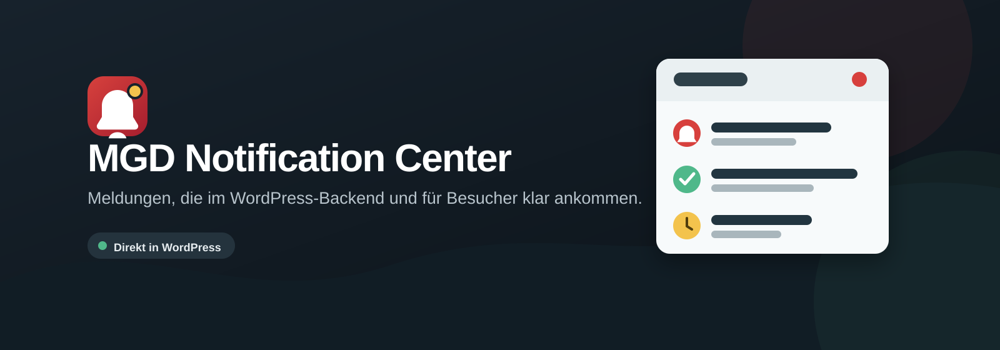

> **WordPress.org-Kandidat:** Dieser Branch verwendet native Verzeichnis-Updates. Paketbau, Prüfergebnisse und Wechselhinweise: [WordPress.org-Vorbereitung](docs/WORDPRESS-ORG.md). Die nachfolgende bisherige Dokumentation beschreibt auch die separate GitHub-Ausgabe.

## Verzeichnisfassung 0.1.4

Die verbliebenen statischen Hinweise wurden gezielt nachgearbeitet. [Änderungen und 41 Integrationstests](docs/wordpress-org/ERGEBNIS.md) sowie [offengelegte Einzel-Ausnahmen](docs/wordpress-org/GEPRUEFTE-AUSNAHMEN.md) dokumentieren den neuen Stand.


Für das WordPress.org-Profil [michaelgahndesign](https://profiles.wordpress.org/michaelgahndesign/) vorbereitet. Vorgeschlagener Slug: `mgd-notification-center`; der endgültige Name wird bei der Aufnahme bestätigt.

- [Einreichungs-Readme](mgd-notification-center/readme.txt) mit Funktionen, Installation, Datenschutz und Screenshots.
- [Prüfbericht](docs/wordpress-org/ERGEBNIS.md) mit Einordnung aller verbleibenden lokalen Plugin-Check-Hinweise.
- [Paketbau, Updatekanal und sicherer Wechsel](docs/WORDPRESS-ORG.md).

`python3 scripts/build-wordpress-org.py` baut das installierbare ZIP mit Prüfsumme. `php tests/wordpress-org-contract.php` prüft Metadaten, Version, Grafiken und den nativen Updatekanal. Verzeichnisgrafiken und echte Backend-Screenshots liegen getrennt unter `wordpress-org/assets`; sie gehören später in den obersten SVN-assets-Ordner.

**Noch nicht eingereicht oder von WordPress.org zugelassen.** Diese Fassung lädt keinen externen Plugin-Katalog und installiert keine GitHub-Updatepakete. Die unten folgende Projektdokumentation enthält zusätzlich die Geschichte und Bedienung der eigenständigen GitHub-Ausgabe auf main. Nicht beide Ausgaben gleichzeitig aktivieren.

---

<div align="center">



# MGD Notification Center

**Öffentliche Neuigkeiten und persönliche Benachrichtigungen für WordPress.**

[](https://wordpress.org/)
[](https://www.php.net/)
[](mgd-notification-center/LICENSE)
[](https://github.com/MichaelGahnDESIGN/MGD-Notification-WordPress/releases/latest)

[Testversion herunterladen](https://github.com/MichaelGahnDESIGN/MGD-Notification-WordPress/releases/latest) · [Dokumentation](https://github.com/MichaelGahnDESIGN/MGD-Notification-WordPress/wiki) · [Sicherheitsrichtlinie](SECURITY.md)

</div>

---

MGD Notification Center bringt eine zugängliche Glocke in WordPress. Sie zeigt neue Inhalte, bewusst angekündigte Aktualisierungen und persönliche Meldungen für angemeldete Konten. Alle Daten bleiben auf dem eigenen WordPress-Server: Das Plugin lädt keine externen Schriften, Skripte oder Analyse-Dienste.

> **Status:** Erste Testversion. Bitte zuerst in einer Staging- oder Testumgebung installieren.

## Auf einen Blick

| Bereich | Enthalten |
| --- | --- |
| Öffentliche Meldungen | Neue veröffentlichte Inhalte und redaktionell freigegebene Aktualisierungen |
| Persönliche Meldungen | WooCommerce-Bestellstatus und gezielte Admin-Nachrichten |
| Platzierung | Hauptmenü, Footer, vier schwebende Ecken oder Shortcode |
| Verwaltung | Entwurf, Planung, Veröffentlichung, Bearbeitung und Archivierung |
| Datenschutz | Empfänger, Lesestatus und persönliche Inhalte bleiben serverseitig getrennt |

## Installation

1. Lade [**MGD Notification Center 0.1.1**](https://github.com/MichaelGahnDESIGN/MGD-Notification-WordPress/releases/download/v0.1.1/mgd-notification-center-0.1.1.zip) herunter.
2. Öffne in WordPress **Plugins → Installieren → Plugin hochladen**.
3. Wähle die ZIP-Datei, installiere sie und aktiviere das Plugin.
4. Stelle unter **Notification Center → Einstellungen** die gewünschte Position ein.
5. Erstelle unter **Notification Center → Meldungen** eine öffentliche oder persönliche Testmeldung.

Eine kurze Schritt-für-Schritt-Anleitung steht in der [Wiki-Installation](https://github.com/MichaelGahnDESIGN/MGD-Notification-WordPress/wiki/Installation).

## Funktionen

### Für Besucherinnen und Besucher

- Glocke mit Zahl für ungelesene Meldungen
- Tastaturbedienung und aussagekräftige ARIA-Beschriftungen
- Öffentliche Meldungen ohne Anmeldung
- Persönliche Meldungen nur für das zugehörige angemeldete Konto
- Lokale Speicherung gelesener **öffentlicher** Meldungen im Browser

### Für die Redaktion

- Öffentliche und persönliche Meldungen erstellen und bearbeiten
- Status **Entwurf**, **geplant**, **veröffentlicht** und **archiviert**
- Linkziel je Meldung
- Automatische öffentliche Meldung beim ersten Veröffentlichen eines Inhalts
- Optionaler Hinweis für eine bewusst angekündigte Inhaltsaktualisierung
- Automatische persönliche Meldung bei WooCommerce-Bestellstatusänderungen, wenn die Bestellung einem WordPress-Konto zugeordnet ist

## Platzierung

Die automatische Position stellst du im Backend ein. Für eine frei gewählte Stelle im Theme oder Page Builder steht dieser Shortcode bereit:

```text
[mgd_notification_center]
```

| Einstellung | Ergebnis |
| --- | --- |
| `floating-top-left` / `floating-top-right` | Schwebende Glocke oben |
| `floating-bottom-left` / `floating-bottom-right` | Schwebende Glocke unten |
| `menu` | Ausgabe über den Theme-Menü-Hook |
| `footer` | Ausgabe im Footer |
| `none` | Keine automatische Ausgabe; nur Shortcode oder Theme-Einbindung |

## Datenschutz und Sicherheit

Persönliche Meldungen werden nie über die öffentliche Schnittstelle ausgeliefert. Jede Lese-Markierung wird auf dem Server mit dem angemeldeten WordPress-Konto abgeglichen. Gastbestellungen erhalten absichtlich keine persönliche Statusmeldung, weil es keine sichere Konto-Zuordnung gibt.

Die Details zu Datenmodell, Berechtigungen und Löschverhalten stehen in der [Wiki: Datenschutz und Sicherheit](https://github.com/MichaelGahnDESIGN/MGD-Notification-WordPress/wiki/Datenschutz-und-Sicherheit).

## Testen und Paket erzeugen

```bash
find mgd-notification-center -name '*.php' -exec php -l {} \;
node --check mgd-notification-center/assets/frontend.js
python3 scripts/check-docs.py
python3 scripts/build-package.py
```

Das fertige ZIP liegt anschließend unter `dist/`.

## Dokumentation

- [Installation](https://github.com/MichaelGahnDESIGN/MGD-Notification-WordPress/wiki/Installation)
- [Meldungen verwalten](https://github.com/MichaelGahnDESIGN/MGD-Notification-WordPress/wiki/Meldungen-verwalten)
- [Datenschutz und Sicherheit](https://github.com/MichaelGahnDESIGN/MGD-Notification-WordPress/wiki/Datenschutz-und-Sicherheit)
- [Entwicklung und Tests](https://github.com/MichaelGahnDESIGN/MGD-Notification-WordPress/wiki/Entwicklung-und-Tests)

## Unterstützung

Fehler, Wünsche und nachvollziehbare Verbesserungsvorschläge bitte als [GitHub Issue](https://github.com/MichaelGahnDESIGN/MGD-Notification-WordPress/issues) melden. Bitte keine Zugangsdaten, personenbezogenen Daten oder vollständigen Datenbankauszüge anhängen.

## Lizenz

Dieses Plugin steht unter [GPL-2.0-or-later](mgd-notification-center/LICENSE).

## 0.1.4 – Plugin-Verwaltung

Separate Update-Prüfung, Plugin-Links und ergänzte lokale Details. [Anleitung](docs/WORDPRESS-VERWALTUNG.md).
